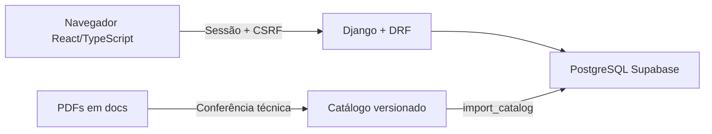

# Arquitetura do Estudo Certo

## Visão geral

Produção: um projeto Vercel. O build compila React; Django entrega a aplicação e a API.
Estáticos são coletados pela Vercel. Interface e API compartilham o domínio.
Local: SQLite para início rápido; CI de integração utiliza PostgreSQL.

Publicação atual: https://estudo-certo-omega.vercel.app. Função e PostgreSQL em São Paulo.
Runtime usa Transaction pooler; migrations e operações administrativas usam Session pooler.
As configurações de produção são separadas do `.env` local; novos dados não são sincronizados entre os bancos.

## Responsabilidades

| Camada | Função |
|---|---|
| `frontend/src/pages` | Estudo, revisão, desempenho, plano e conta. |
| `frontend/src/components` | Componentes visuais e interação da questão. |
| `frontend/src/api` | Cliente HTTP e tipos gerados do OpenAPI. |
| `study/views.py` e `serializers.py` | Autenticação, validação e contrato HTTP. |
| `study/services.py` | Seleção, métricas e prioridades. |
| `study/models.py` | Catálogo, referências, versões e histórico. |
| `content/statute.py` e `content/expansion.*` | Catálogo original e lote editorial de 240 questões com fundamentos. |
| `study/management/commands` | Importação, contas e privacidade do banco. |
| `config` | Configuração, URLs e entrada WSGI. |

## Dados

- Disciplina → temas → questões.
- Documento → trechos de referência → questões.
- Questão: revisão, alternativas, gabarito, comentários e estado editorial.
- Tentativa: usuário e revisão respondida.
- Perfil: meta diária de minutos.
- Janela de login: limite de tentativas, com identificadores opacos.

Questão respondida não pode ser editada em lugar. Crie nova revisão e arquive a anterior.
O histórico é preservado; a seleção usa a revisão publicada mais nova.
Questões com duas assertivas mantêm as duas referências. Cada lote editorial conserva
ordem e identificadores; futuras expansões devem criar outro lote.

Tema visual é uma preferência local do navegador, aplicada antes da montagem do React.
Não altera perfil, API ou esquema do banco.

## Responder uma questão

1. Cliente recebe enunciado e alternativas, sem gabarito ou comentários.
2. Estudante confirma uma escolha com identificador único de envio.
3. Django valida, corrige e persiste.
4. Servidor devolve comentários e fundamento com artigo/página.
5. Painel é atualizado. Reenvio idêntico não cria outra tentativa.

## Métricas

| Métrica | Regra |
|---|---|
| Aproveitamento | Acertos ÷ tentativas do período. |
| Primeiro contato | Acertos na primeira tentativa por questão, quando essa primeira tentativa está no período. |
| Cobertura | Questões distintas respondidas ÷ catálogo disponível; todo o histórico. |
| Erros pendentes | Questões disponíveis cuja resposta mais recente foi incorreta. |
| Amostra insuficiente | Menos de cinco questões distintas no tema durante o período. |
| Prioridade | Erros pendentes, temas não iniciados e menor aproveitamento. |

Dia de estudo: `America/Sao_Paulo`. O painel não prevê aprovação.

## Segurança e limites

- Sessão Django, CSRF, senhas com hash e rotas privadas.
- Credenciais no ambiente; sem conexão direta React → banco.
- Tabelas Django sem privilégios para `anon`/`authenticated` no Supabase.
- Produção falha sem chave secreta e PostgreSQL.
- Sem cadastro público, envio de senha por e-mail, OCR ou IA em tempo de execução.
- PDFs preservados em `docs/`, excluídos do pacote executável.
- V1 cobre uma seleção do estatuto. Outras disciplinas reutilizarão a estrutura.
